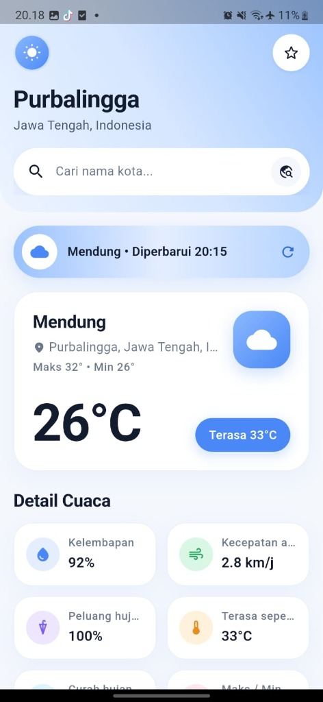
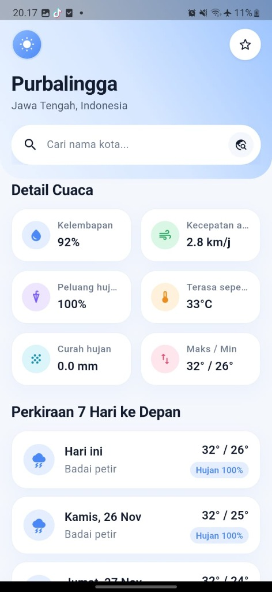
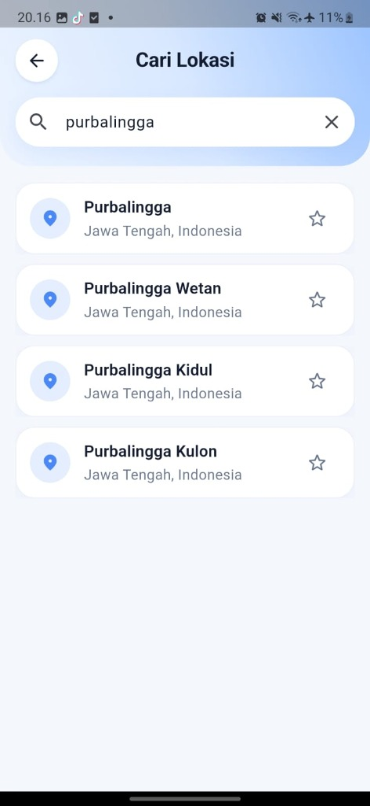

# Weather App — Responsi 2 Praktikum Pemrograman Mobile (Flutter)
 Nama : Edgina Syafa Ayu Wicaksono
 Shift KRS : D
 Link YouTube : https://youtu.be/3zhyMLuK4Z8

 
Aplikasi informasi cuaca berbasis **Flutter (Dart)** yang mengambil data cuaca real-time dan perkiraan 7 hari ke depan dari **Open-Meteo REST API**, dibangun menggunakan arsitektur **Model-View-ViewModel (MVVM)**, state management **Provider**, Material Design 3, serta penyimpanan lokal **SharedPreferences**.

---

## Fitur Utama

- **Home / Weather Screen**
  - Menampilkan nama kota yang dipilih, kondisi cuaca terkini (ikon & deskripsi dari kode WMO), suhu saat ini, dan waktu pembaruan.
  - Menampilkan detail cuaca lengkap: suhu terasa seperti, kelembapan udara, kecepatan angin, curah hujan, peluang hujan maksimum, serta suhu maksimum/minimum hari ini.
  - Menampilkan perkiraan cuaca 7 hari ke depan beserta peluang hujan harian.
  - Mendukung *pull-to-refresh* dan tombol favorit langsung dari halaman utama.
- **Search / Location Screen**
  - Pencarian kota secara langsung ke **Open-Meteo Geocoding API** dengan *debounce* 500 ms.
  - Menyimpan dan menghapus **lokasi favorit** serta mencatat **riwayat pencarian** (maksimal 10 lokasi terakhir) di **Local Storage** (`SharedPreferences`) sehingga otomatis dimuat kembali saat aplikasi dibuka.
- **Penanganan State Lengkap**
  - Menangani kondisi `loading`, `empty` (belum ada lokasi / kota tidak ditemukan), `error` (tanpa internet, timeout, kesalahan server), dan `success`.

---

## Struktur Aplikasi

```text
lib/
├── main.dart                         # Entry point, inisialisasi locale id_ID & MultiProvider
├── models/
│   ├── location_model.dart           # Model lokasi (Geocoding API & JSON Local Storage)
│   └── weather_model.dart            # Model CurrentWeather, DailyForecast, dan WeatherModel
├── services/
│   ├── weather_service.dart          # HTTP GET ke Open-Meteo Forecast & Geocoding API
│   └── storage_service.dart          # Local Storage (SharedPreferences) untuk favorit, riwayat, lokasi terakhir
├── viewmodels/
│   ├── weather_viewmodel.dart        # State management Home Screen (ViewState, loadWeather, refresh)
│   └── search_viewmodel.dart         # State management Search Screen (pencarian, favorit, riwayat)
├── views/
│   ├── home_screen.dart              # Home / Weather Screen (StatelessWidget)
│   └── search_screen.dart            # Search / Location Screen (StatefulWidget)
├── widgets/
│   ├── current_weather_card.dart     # Banner status gradien & kartu cuaca utama
│   ├── weather_details.dart          # Grid responsif 6 detail cuaca dengan badge pastel
│   ├── forecast_tile.dart            # Kartu perkiraan cuaca harian
│   ├── location_tile.dart            # Kartu item hasil pencarian, favorit, & riwayat
│   └── state_message.dart            # Tampilan kondisi data kosong & error
├── theme/
│   └── app_theme.dart                # Material 3 Theme (terang & gelap), palet warna, & Typography
└── utils/
    └── weather_code.dart             # Pemetaan kode cuaca WMO ke deskripsi bahasa Indonesia & ikon
```

---

## Implementasi API (Open-Meteo)

Seluruh permintaan jaringan dilakukan menggunakan package `http` dengan metode **`GET`** di `lib/services/weather_service.dart`.

### 1. Geocoding API (Pencarian Kota)
- **Endpoint:** `GET https://geocoding-api.open-meteo.com/v1/search`
- **Parameter:** `name`, `count=10`, `language=id`, `format=json`
- **Hasil:** Daftar JSON dikonversi menjadi `List<LocationModel>` (nama kota, wilayah/provinsi, negara, `latitude`, `longitude`).

### 2. Weather Forecast API (Data Cuaca)
- **Endpoint:** `GET https://api.open-meteo.com/v1/forecast`
- **Parameter penting:**
  - `latitude` & `longitude` (koordinat lokasi terpilih)
  - `current` (data cuaca terkini)
  - `daily` (perkiraan harian)
  - `timezone=auto`
  - `forecast_days=7`

### Pemetaan Field API yang Ditampilkan

| Informasi | Field Open-Meteo API | Lokasi Tampilan |
| :--- | :--- | :--- |
| Suhu saat ini | `current.temperature_2m` | `CurrentWeatherCard` |
| Kelembapan | `current.relative_humidity_2m` | `WeatherDetails` |
| Suhu yang dirasakan | `current.apparent_temperature` | `CurrentWeatherCard` & `WeatherDetails` |
| Curah hujan | `current.precipitation` | `WeatherDetails` |
| Kode kondisi cuaca | `current.weather_code` | `CurrentWeatherCard` (via `weather_code.dart`) |
| Kecepatan angin | `current.wind_speed_10m` | `WeatherDetails` |
| Suhu maksimum harian | `daily.temperature_2m_max` | `WeatherDetails` & `ForecastTile` |
| Suhu minimum harian | `daily.temperature_2m_min` | `WeatherDetails` & `ForecastTile` |
| Peluang hujan maksimum | `daily.precipitation_probability_max` | `WeatherDetails` & `ForecastTile` |

---

## Penerapan Arsitektur MVVM

Aplikasi menerapkan pola **Model-View-ViewModel (MVVM)** dengan `Provider` (`ChangeNotifier`):

1. **Model (`lib/models/`)**
   - `WeatherModel`, `CurrentWeather`, `DailyForecast`, dan `LocationModel` bertanggung jawab memetakan respons JSON dari API dan serialisasi JSON untuk `SharedPreferences`.
2. **Service (`lib/services/`)**
   - `WeatherService` menangani komunikasi HTTP `GET` dan validasi error jaringan (`SocketException`, `TimeoutException`, `ClientException`, status HTTP non-200).
   - `StorageService` menangani penyimpanan dan pembacaan data lokal (lokasi favorit, riwayat pencarian, lokasi terakhir).
3. **ViewModel (`lib/viewmodels/`)**
   - `WeatherViewModel` dan `SearchViewModel` mewarisi `ChangeNotifier`, memanggil Service, mengelola status (`loading`, `empty`, `error`, `success`), serta memanggil `notifyListeners()` agar UI diperbarui secara reaktif.
4. **View (`lib/views/` & `lib/widgets/`)**
   - `HomeScreen` dan `SearchScreen` hanya bertugas merender UI berdasarkan state yang disediakan ViewModel melalui `Consumer` dan meneruskan aksi pengguna kembali ke ViewModel.

---

## Screenshot Aplikasi

| Home Screen (Cuaca Terkini) | Home Screen (Detail & Perkiraan 7 Hari) | Search Screen (Hasil Pencarian API) |
| :---: | :---: | :---: |
|  |  |  |

| Search Screen (Riwayat & Favorit) | Empty State (Kota Tidak Ditemukan) | Error State (Tanpa Internet) |
| :---: | :---: | :---: |
|  |  |  |

---

## Cara Menjalankan

```bash
flutter pub get
flutter run
```
